<div align="center">

# earnings-card

### Type a ticker. Get a carousel of earnings cards worth posting.

An agent skill that turns the latest SEC filing of any US-listed company into **7 editorial-grade cards**: headline, revenue mix, profit waterfall, margin trend, cash flow, management guidance, and a landscape cover.

[简体中文](./README.md) · **English** · [**Live gallery: full Mag 7 card sets →**](https://ttnan.github.io/earnings-card/?lang=en)


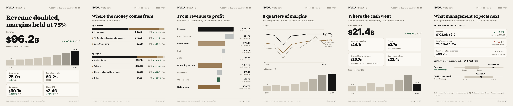

</div>

```
> Make an earnings card for NVDA
```

That's the whole prompt. The agent pulls the 10-Q straight from SEC EDGAR, writes a one-line takeaway from the numbers, and renders the set as PNG, SVG and one HTML page.

---

## Why

Earnings season is a wall of tables, press-release adjectives and screenshots of Bloomberg terminals. What people actually share is **one clean image that says what happened**.

earnings-card makes that image for you, from the filing itself:

- **Official data only.** Every number comes from the company's own SEC filing (XBRL). No scraping, no paid API, no key.
- **A story, not a spreadsheet.** Seven cards that read like a magazine spread, sized 1080×1350 for X, Threads, Instagram and Xiaohongshu carousels.
- **Things screenshots can't show.** Revenue by business and by region, parsed from the filing's own XBRL. Last quarter's guidance checked against what actually happened.
- **Honest headlines.** The takeaway is written only from numbers in the data. No price targets, no buy/sell calls, no invented reasons.

## The seven cards

<table>
<tr>
<td width="33%">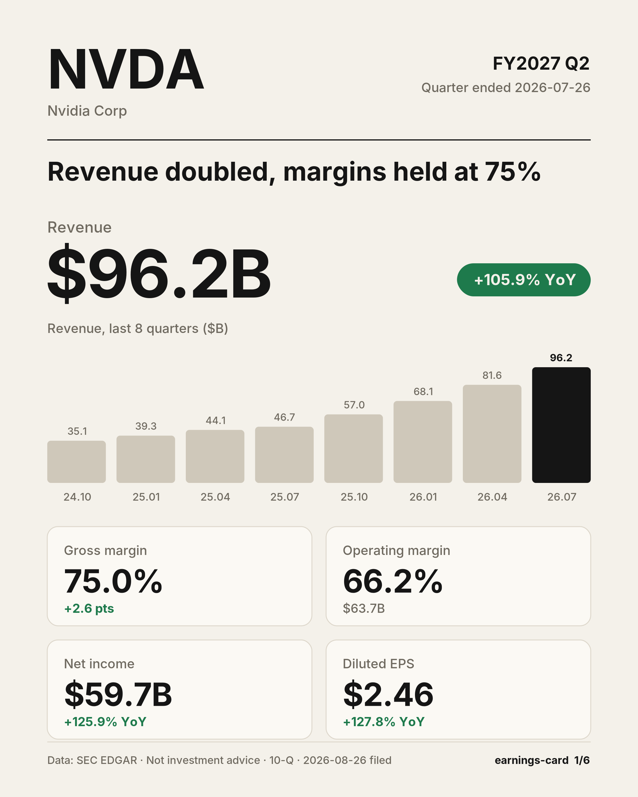<br><b>1 · Cover</b><br>One-line takeaway, revenue and YoY, 8-quarter bars, margins, net income, EPS</td>
<td width="33%">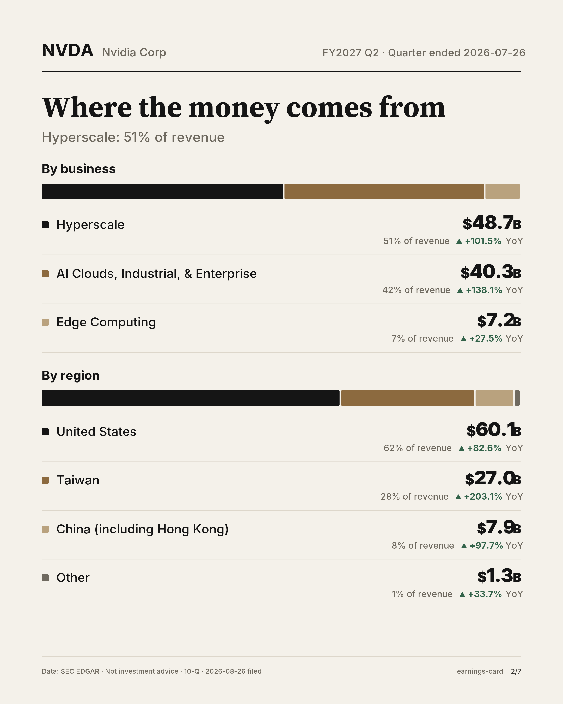<br><b>2 · Where the money comes from</b><br>Revenue by business and by region, with share and YoY</td>
<td width="33%">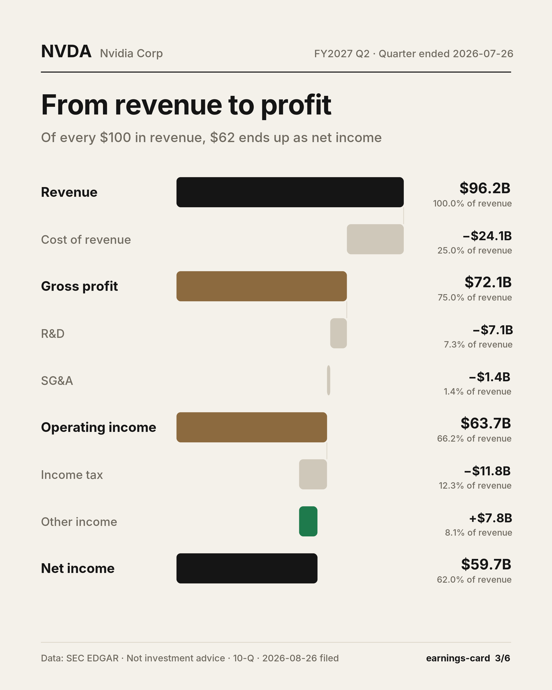<br><b>3 · Profit waterfall</b><br>From every $100 of revenue down to net income</td>
</tr>
<tr>
<td>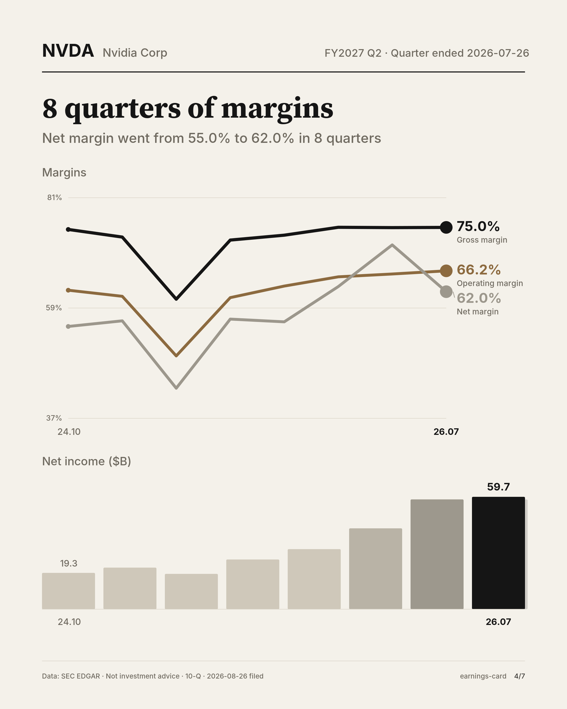<br><b>4 · Margin trend</b><br>Gross, operating and net margin over 8 quarters</td>
<td>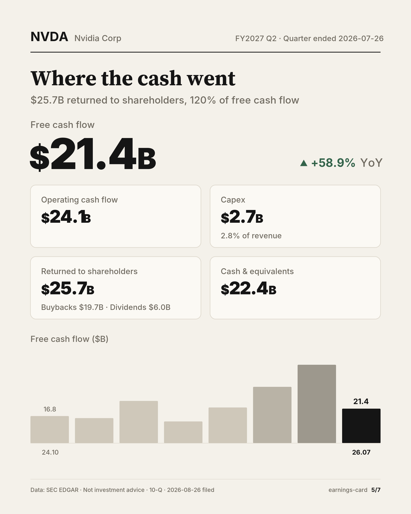<br><b>5 · Cash flow</b><br>Operating cash, capex, free cash flow, buybacks, dividends, cash pile</td>
<td>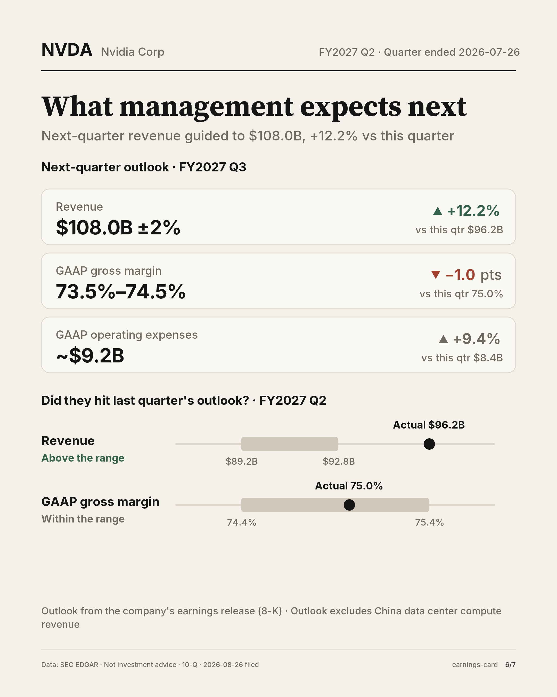<br><b>6 · Guidance</b><br>Next quarter's outlook, and did they hit last quarter's?</td>
</tr>
</table>

**7 · Landscape cover**, 1600×900 for X posts, articles and slides:

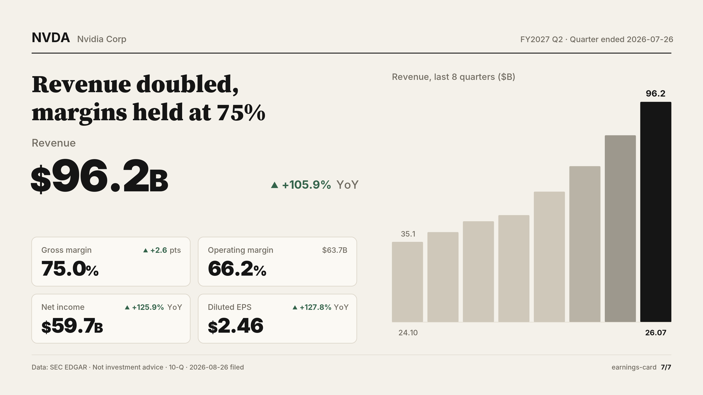

## Dark mode, any company

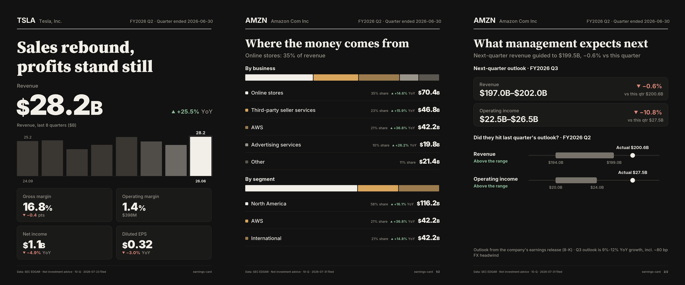

<table>
<tr>
<td width="50%">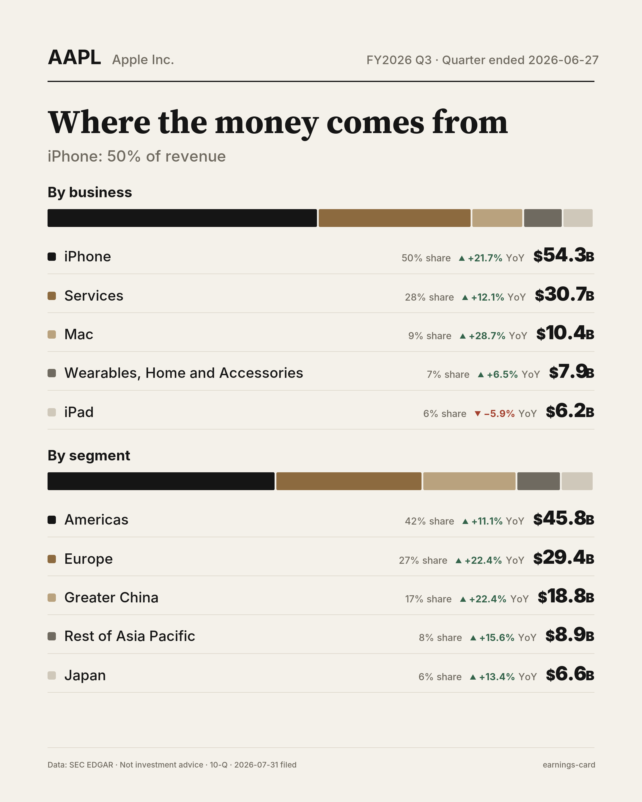<br>Apple: iPhone brought in 50% of revenue, up 21.7%</td>
<td width="50%">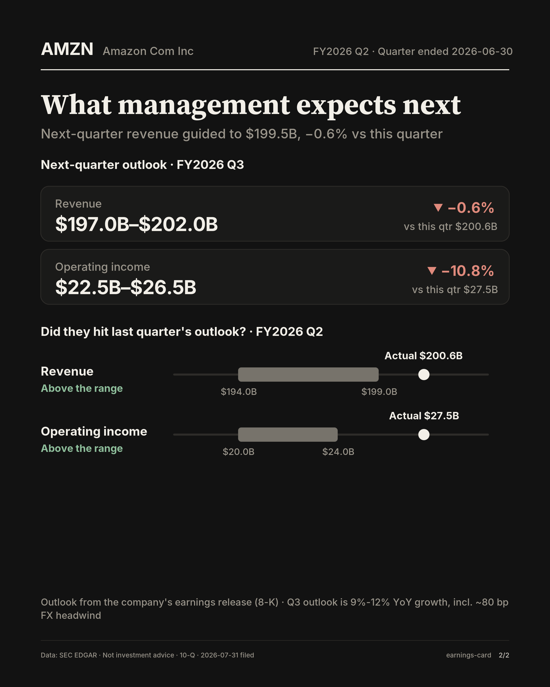<br>Amazon: revenue and operating income both landed above their own guidance</td>
</tr>
</table>

## Six styles, or bring your own

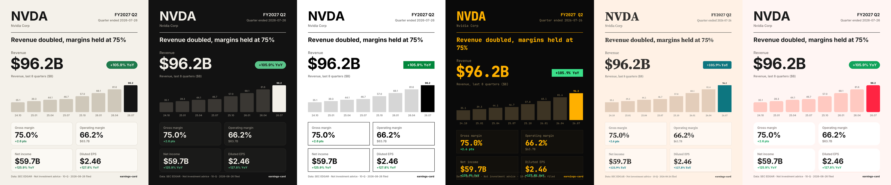

`paper` `ink` `mono` `terminal` `salmon` `pop`. Just ask: "Make NVDA cards in the terminal style".

Want your own colors, font, @handle and avatar watermark? One small JSON file ([guide](skills/earnings-card/styles/README.md)):

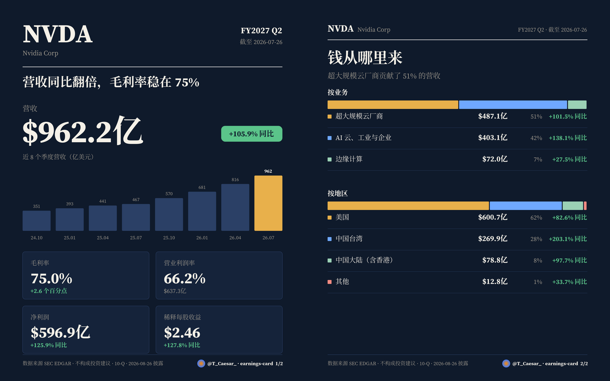

## Install

```bash
npx skills add TTNAN/earnings-card
```

Or copy `skills/earnings-card` into your agent's skills folder (Claude Code: `~/.claude/skills/`, Codex: `~/.codex/skills/`).

Needs Python 3.9+. For PNG export: `pip install cairosvg`. Without it you still get SVG and HTML.

SEC asks every client to identify itself, so set a contact once:

```bash
export SEC_USER_AGENT="your-name you@example.com"
```

## Use

Talk to your agent:

```
Make an earnings card for AAPL
Earnings cards for MSFT, dark theme
给 NVDA 做一套中文财报卡
Just the cover and cash flow cards for TSLA
```

Or run the scripts yourself:

```bash
cd skills/earnings-card/scripts
python3 fetch_sec.py NVDA --out nvda.json
python3 render.py nvda.json --out NVDA --headline "Revenue doubled, margins held at 75%" --lang en --png
```

| Option | What it does |
|---|---|
| `--lang en\|zh` | English or Chinese cards |
| `--theme light\|dark` | Warm paper or ink black |
| `--cards cover,mix,profit,trend,cash,guide,wide` | Pick the cards you want |
| `--guidance guidance.json` | Add the guidance card (the agent writes this from the earnings release) |
| `--labels labels.json` | Rename segments, e.g. into Chinese |
| `--png` | Export PNG next to the SVG |

## How it works

```
ticker ─▶ SEC EDGAR companyfacts ─▶ 8 quarters of GAAP numbers
       └▶ the 10-Q/10-K XBRL itself ─▶ revenue by business and region
       └▶ the 8-K earnings release   ─▶ guidance text ─▶ agent turns it into numbers
                                        │
                     agent writes one headline from the data only
                                        │
                     render.py ─▶ 7 cards · SVG · PNG · HTML
```

- Q4 figures and quarterly cash flow are derived the standard way (full year minus the first three quarters, year-to-date differences) and labeled as derived.
- Segment splits pick the most detailed set of members that adds up to total revenue, so subtotals never double-count.

## Limits

- US companies that file with the SEC. A-shares and Hong Kong are on the roadmap.
- GAAP numbers, which can differ from the adjusted figures in press releases.
- Revenue mix needs a 10-Q; for a fiscal Q4 (reported in the 10-K) that card is skipped.
- Guidance only when the company puts numbers in its earnings release. Apple, Microsoft and Tesla give theirs on the call, so that card is skipped for them.

## Development

Correct numbers are the whole product, so every number printed on every card is covered by golden tests (`tests/golden`), and the segment-splitting logic has its own unit tests. No dependencies needed:

```bash
python3 -m unittest discover -s tests
```

After an intentional card change, refresh the snapshots with `UPDATE_GOLDEN=1` and explain the diff in your PR.

## Roadmap

- [ ] Beat / miss vs consensus (bring your own estimates)
- [ ] Banks and insurers layout
- [x] [Online gallery for every Mag 7 report](https://ttnan.github.io/earnings-card/?lang=en)
- [ ] A-shares and Hong Kong stocks

Ideas and bug reports are welcome in issues.

## Buy me a coffee

If this saved you some time, feel free to buy me a coffee. ☕

| Alipay | WeChat Pay |
| ------ | ---------- |
|  |  |

## License

MIT, see [LICENSE](LICENSE). Not investment advice.
