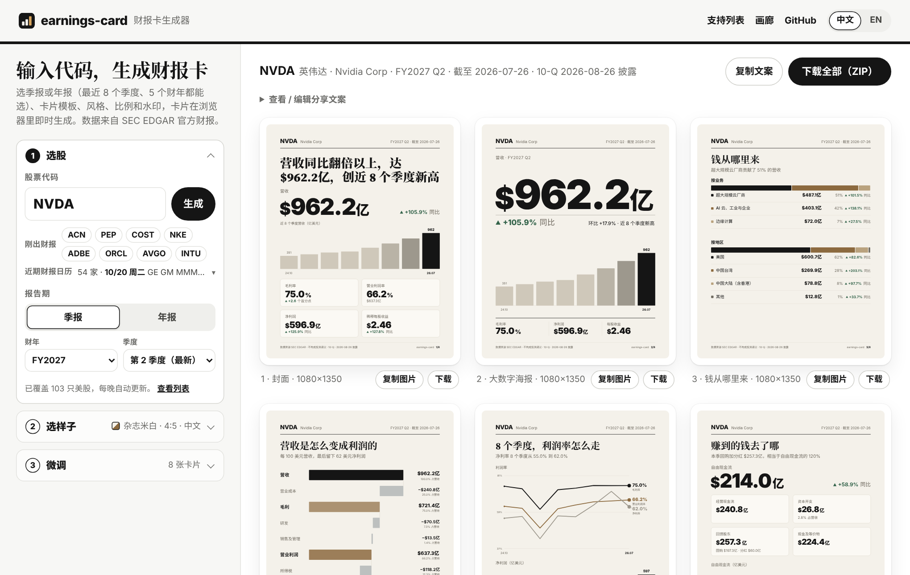
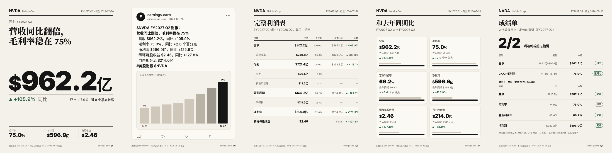

<div align="center">

# earnings-card · 财报卡

### 输入一个股票代码，得到一整套能直接发出去的财报图。

一个 Agent skill：读取美股公司最新（或你指定的那一期）的 SEC 财报，生成 **7 张杂志质感的卡片**：一句话结论、钱从哪里来、利润拆解、利润率趋势、现金流、管理层指引，外加一张横版封面；另有大数字海报、推文截图、完整利润表、同比对比、记分牌五种模板，12 种风格。

**简体中文** · [English](./README.en.md) · [**在线生成器：输入代码直接出图 →**](https://earningscard.tech/) · [七巨头画廊](https://earningscard.tech/gallery/)


</div>

```
> 给 NVDA 做一套财报卡
```

就这一句。Agent 直接从 SEC EDGAR 拉取季报，只根据数字写一句结论，输出 PNG、SVG 和一个 HTML 汇总页。

## 不想装？在线生成

**[earningscard.tech](https://earningscard.tech/)**：三步出图。

1. **选股**：输入代码或中文名（「英伟达」也行），自动补全；「刚出财报」一键直达最新披露的公司，下面还有未来 14 天的财报日历。选季报或年报，以及具体哪个财年、哪个季度（最近 8 个季度、5 个财年）。
2. **选样子**：12 种风格（带缩略图）、4 种比例（4:5 / 1:1 / 9:16 / 16:9）、中英文。
3. **微调**：勾选要哪几张卡、改标题（会按数据给出几条建议）、@账号和头像水印，常用设置可以存成预设。

卡片一张张在浏览器里画出来，可以复制图片、单张下载 PNG、一键打包 ZIP，还会顺手生成一段能直接发帖的配文。



- 免费，不用注册，不用装任何东西，托管在 GitHub Pages 上，没有服务器。国内网络也能打开（渲染引擎会自动挑最快的镜像）。
- 浏览器里跑的就是本仓库的 `render.py`（通过 Pyodide），和命令行出来的卡一模一样。
- 数据每晚由 GitHub Actions 从 SEC EDGAR 预先拉好，目前覆盖 103 只美股（[支持列表](https://earningscard.tech/tickers/)，名单在 [`tools/tickers.txt`](tools/tickers.txt)，可以一直加到标普 500）。
- 想看现成的整套卡片：[七巨头画廊](https://earningscard.tech/gallery/)。

---

## 为什么做这个

每到财报季，信息流里全是表格、新闻稿里的形容词和终端截图。真正会被转发的，是**一张一眼看懂发生了什么的图**。

earnings-card 直接从财报原文帮你做这张图：

- **只用官方数据。** 每个数字都来自公司自己提交给 SEC 的财报（XBRL）。不爬网页，不用付费 API，不需要 key。
- **讲故事，不是贴表格。** 7 张卡片像一篇杂志专题，竖版 1080×1350，直接发小红书、X、朋友圈多图。
- **按杂志的标准排版。** 衬线标题配粗黑数字，一套统一的页眉和 n/N 编号；图表只标首尾和最新一期，涨跌统一用 ▲▼ 和克制的墨绿、陶土红，不堆小数字。
- **截图给不了的东西。** 分业务、分地区营收，直接从财报原始 XBRL 里拆；上季度管理层给的指引，和这季实际结果放在一起对照。
- **结论克制。** 一句话结论只基于数据里的数字：不给目标价，不荐股，不编造原因。

## 七张卡

<table>
<tr>
<td width="33%"><br><b>1 · 封面</b><br>一句话结论、营收与同比、近 8 季营收、利润率、净利润、EPS</td>
<td width="33%"><br><b>2 · 钱从哪里来</b><br>分业务、分地区营收，占比和同比</td>
<td width="33%"><br><b>3 · 利润拆解</b><br>每 100 美元营收，一步步变成多少净利润</td>
</tr>
<tr>
<td><br><b>4 · 利润率趋势</b><br>8 个季度的毛利率、营业利润率、净利率</td>
<td><br><b>5 · 现金流</b><br>经营现金流、资本开支、自由现金流、回购分红、账上现金</td>
<td><br><b>6 · 管理层指引</b><br>下季指引怎么说，上季指引兑现了没有</td>
</tr>
</table>

**7 · 横版封面**，1600×900，适合 X、公众号头图和 PPT：


## 深色主题，任何公司


<table>
<tr>
<td width="50%"><br>苹果：iPhone 贡献一半营收，同比增长 21.7%</td>
<td width="50%"><br>亚马逊：营收和营业利润都超出了自己给的指引上限</td>
</tr>
</table>

## 再加五种模板



不在默认那套里，想要的时候点名就行（在线生成器里勾选即可，大数字海报默认勾上）：

- **大数字海报** `poster`：只放一个数字，营收和同比，越大越好。
- **推文截图风** `post`：做成一条帖子的样子，用你设置的 @账号和头像（没设就是 earnings-card），几行要点加一张小图。不编造点赞转发数。
- **完整利润表** `income`：从营收一路到每股收益，带占营收比例、去年同期和同比。
- **同比对比卡** `yoy`：本期和去年同期并排，六个指标，涨跌带箭头。
- **记分牌** `score`：有指引时，对比管理层上一期给的指引；没有就对比上一季度（年报对比上一财年）。卡片上写明比的是什么。这里没有市场一致预期数据，所以不说「超预期 / 不及预期」。

## 十二种风格，也能用你自己的


`杂志米白` `墨黑` `极简黑白` `终端` `财经报纸` `小红书色块` `彭博橙` `苹果发布会` `赛博霓虹` `复古报纸` `莫兰迪` `毛玻璃渐变`，一句话切换：「用莫兰迪风格给 NVDA 做一套」。

想要自己的配色、字体、@账号和头像水印？写一个小 JSON 就行（[说明](skills/earnings-card/styles/README.md)）：


## 安装

```bash
npx skills add TTNAN/earnings-card
```

或者把 `skills/earnings-card` 复制到你的 Agent skills 目录（Claude Code：`~/.claude/skills/`，Codex：`~/.codex/skills/`）。

需要 Python 3.9+。导出 PNG 需要 `pip install cairosvg`，不装也能输出 SVG 和 HTML。

SEC 要求每个请求带上联系方式，设置一次即可：

```bash
export SEC_USER_AGENT="your-name you@example.com"
```

## 用法

直接对 Agent 说：

```
给 NVDA 做一套中文财报卡
苹果最新财报，做成深色的
只要特斯拉的封面和现金流两张
Make an earnings card for AAPL
```

也可以自己跑脚本：

```bash
cd skills/earnings-card/scripts
python3 fetch_sec.py NVDA --out nvda.json
python3 render.py nvda.json --out NVDA --headline "营收同比翻倍，毛利率稳在 75%" --lang zh --png

# 年报（10-K）：全年数据、同比上一财年、近 5 年趋势；再换个方图比例
python3 fetch_sec.py NVDA --period annual --out nvda-fy.json
python3 render.py nvda-fy.json --out NVDA-FY --ratio 1:1 --png

# 历史某一期：按公司自己的财年编号（或按截止日期）选；--list 列出有哪些期
python3 fetch_sec.py NVDA --list
python3 fetch_sec.py NVDA --fy 2026 --fq 2 --out nvda-26q2.json
python3 render.py nvda-26q2.json --out NVDA-26Q2 --style morandi --cards cover,poster,yoy,score --png
```

`fetch_sec.py --period quarter|annual`：默认季报；`annual` 读年报 10-K，卡片上的「季度」会自动换成「财年」，指引卡只有季报才有。`--fy 2026 --fq 2` 或 `--period-end 2025-07-27` 选历史上的某一期，趋势图截止到那一期。

| 参数 | 作用 |
|---|---|
| `--lang en\|zh` | 英文或中文 |
| `--ratio 4:5\|1:1\|9:16\|16:9` | 图片比例：竖版（默认，1080×1350）、方图、长图（Stories）、横版（1920×1080） |
| `--style light\|dark\|mono\|terminal\|salmon\|pop\|bloomberg\|keynote\|neon\|vintage\|morandi\|glass` 或 `my-style.json` | 十二种内置风格，或你自己的配色、字体、水印 |
| `--cards cover,mix,profit,trend,cash,guide,wide` | 选择要哪几张；另有 `poster,post,income,yoy,score` 五种模板可加 |
| `--period quarter\|annual`、`--fy`/`--fq`、`--period-end` | 用在线生成器的多期数据文件（`docs/data/NVDA.json`）时，选季报/年报和具体哪一期 |
| `--guidance guidance.json` | 加上指引卡（Agent 从财报新闻稿里整理） |
| `--labels labels.json` | 给分部改名，比如翻成中文 |
| `--png` | 同时导出 PNG |

## 原理

```
股票代码 ─▶ SEC EDGAR companyfacts ─▶ 近 8 季 GAAP 数据
        └▶ 10-Q/10-K 原始 XBRL     ─▶ 分业务、分地区营收
        └▶ 8-K 财报新闻稿          ─▶ 指引原文 ─▶ Agent 整理成数字
                                        │
                        Agent 只根据数据写一句结论
                                        │
                        render.py ─▶ 7 张卡 · SVG · PNG · HTML
```

- 第四季度和单季现金流按标准方法推算（全年减前三季、累计值差分），并标注为推算。
- 分部拆分会自动挑出加总等于总营收、颗粒度最细的一组，不会把小计重复算进去。

## 限制

- 仅支持在 SEC 申报的美股公司，A 股、港股在路线图上。
- GAAP 口径，可能和新闻稿里的调整后数字不同。
- 季报模式下，财年第四季度是推算值（全年减前三季），没有单季分部数据，这张卡会跳过；年报模式有全年分部数据。
- 在线生成器只覆盖预先拉好数据的股票（目前 103 只），每只保留最近 8 个季度和 5 个财年，银行等个别公司的季度数据标签特殊，可能只有年报。
- 只有公司在新闻稿里给出数字指引时才有指引卡。苹果、微软、特斯拉只在电话会上讲，这张卡会自动跳过。

## 开发

数字对不对是这个项目的命，所以每张卡上印出来的每个数字都有金标测试（`tests/golden`），分部拆分逻辑另有单测。不需要装任何依赖：

```bash
python3 -m unittest discover -s tests
```

`python3 tools/check_layout.py` 会把所有样例 × 4 种比例 × 12 种风格 × 12 种卡片 × 中英文都渲染一遍（`--data` 则跑 `docs/data` 里每只股票的每一期），检查有没有文字出界或互相重叠（需要装好字体才准）。`python3 tools/build_data.py NVDA` 生成在线生成器用的数据（`docs/data/`）。

有意改动卡片后，用 `UPDATE_GOLDEN=1` 重新生成快照，并在 PR 里说明变化。

## 路线图

- [ ] 对比市场一致预期，看超预期还是不及预期（自带预期值）
- [ ] 银行、保险公司专用版式
- [x] [七巨头财报在线画廊](https://earningscard.tech/gallery/)
- [x] [在线生成器](https://earningscard.tech/)：输入代码、选风格比例水印，浏览器里直接出图
- [x] 年报模式、四种图片比例
- [x] 选历史财年 / 季度，五种新模板，十二种风格
- [x] 中文名搜索、刚出财报快捷入口、财报日历、复制图片和配文
- [ ] A 股、港股

欢迎在 issue 里提想法和 bug。

## 请我喝杯咖啡

如果这个项目帮你省了点时间，欢迎请我喝杯咖啡。☕

| 支付宝 | 微信支付 |
| ------ | -------- |
|  |  |

## 协议

MIT，见 [LICENSE](LICENSE)。不构成投资建议。
