<div align="center">

# earnings-card · 财报卡

### 输入一个股票代码，得到一整套能直接发出去的财报图。

一个 Agent skill：读取美股公司最新的 SEC 财报，生成 **7 张杂志质感的卡片**：一句话结论、钱从哪里来、利润拆解、利润率趋势、现金流、管理层指引，外加一张横版封面。

**简体中文** · [English](./README.en.md) · [**在线画廊：七巨头整套财报卡 →**](https://ttnan.github.io/earnings-card/)


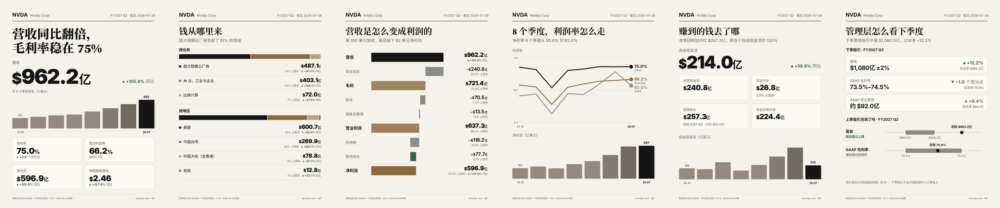

</div>

```
> 给 NVDA 做一套财报卡
```

就这一句。Agent 直接从 SEC EDGAR 拉取季报，只根据数字写一句结论，输出 PNG、SVG 和一个 HTML 汇总页。

---

## 为什么做这个

每到财报季，信息流里全是表格、新闻稿里的形容词和终端截图。真正会被转发的，是**一张一眼看懂发生了什么的图**。

earnings-card 直接从财报原文帮你做这张图：

- **只用官方数据。** 每个数字都来自公司自己提交给 SEC 的财报（XBRL）。不爬网页，不用付费 API，不需要 key。
- **讲故事，不是贴表格。** 7 张卡片像一篇杂志专题，竖版 1080×1350，直接发小红书、X、朋友圈多图。
- **截图给不了的东西。** 分业务、分地区营收，直接从财报原始 XBRL 里拆；上季度管理层给的指引，和这季实际结果放在一起对照。
- **结论克制。** 一句话结论只基于数据里的数字：不给目标价，不荐股，不编造原因。

## 七张卡

<table>
<tr>
<td width="33%">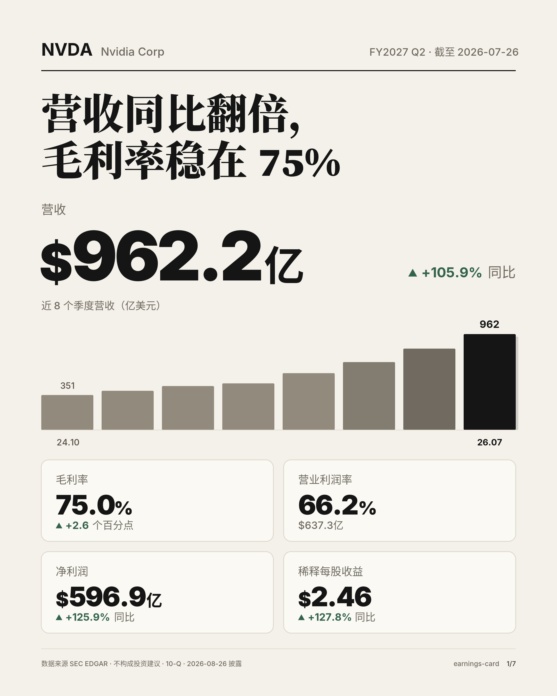<br><b>1 · 封面</b><br>一句话结论、营收与同比、近 8 季营收、利润率、净利润、EPS</td>
<td width="33%">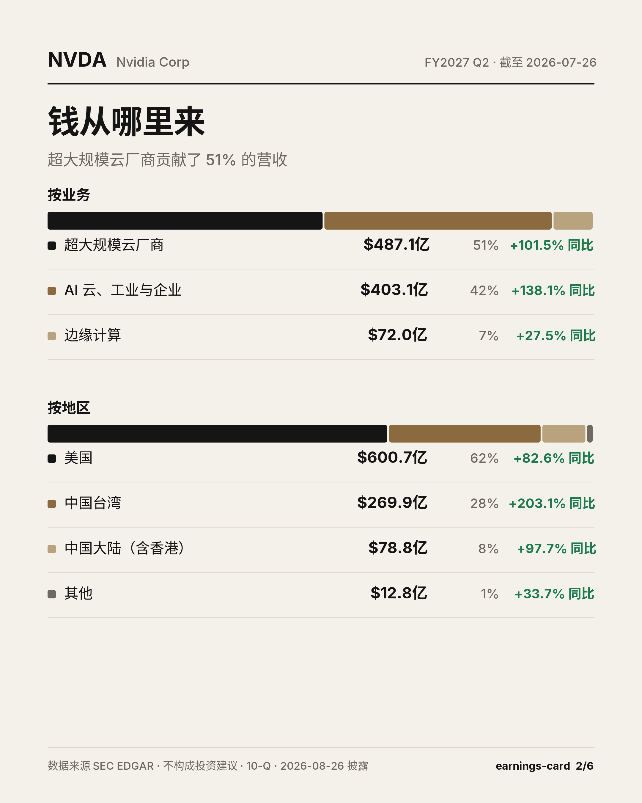<br><b>2 · 钱从哪里来</b><br>分业务、分地区营收，占比和同比</td>
<td width="33%">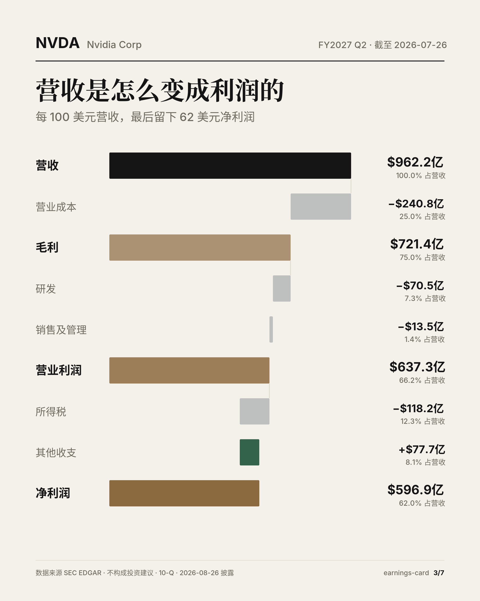<br><b>3 · 利润拆解</b><br>每 100 美元营收，一步步变成多少净利润</td>
</tr>
<tr>
<td>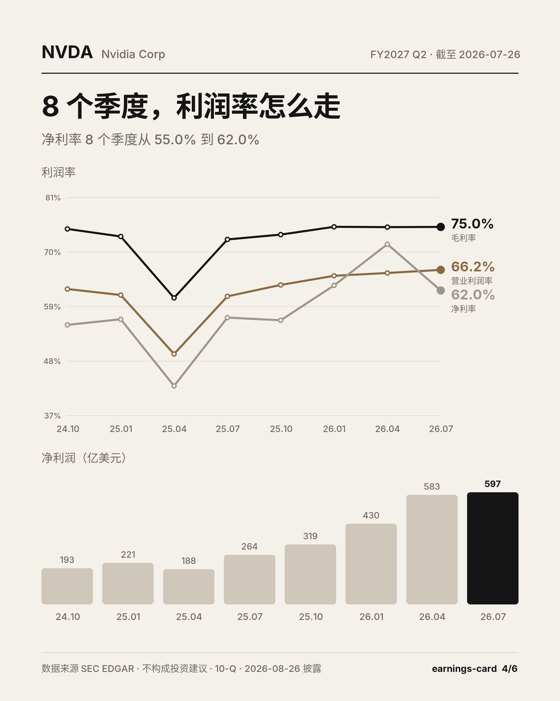<br><b>4 · 利润率趋势</b><br>8 个季度的毛利率、营业利润率、净利率</td>
<td>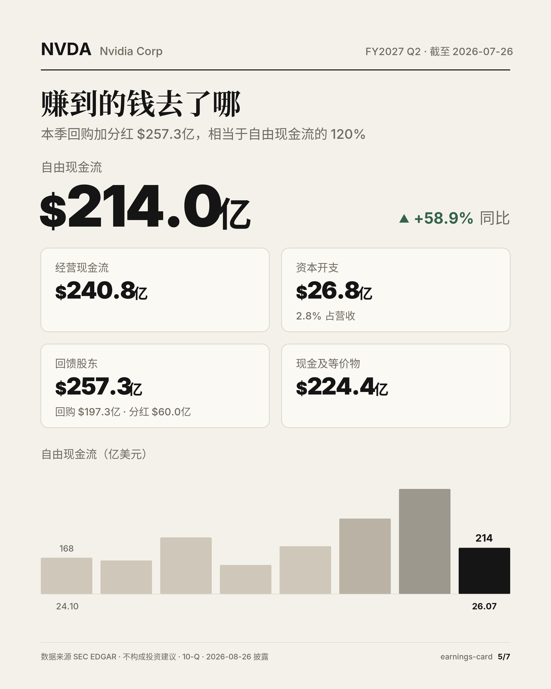<br><b>5 · 现金流</b><br>经营现金流、资本开支、自由现金流、回购分红、账上现金</td>
<td>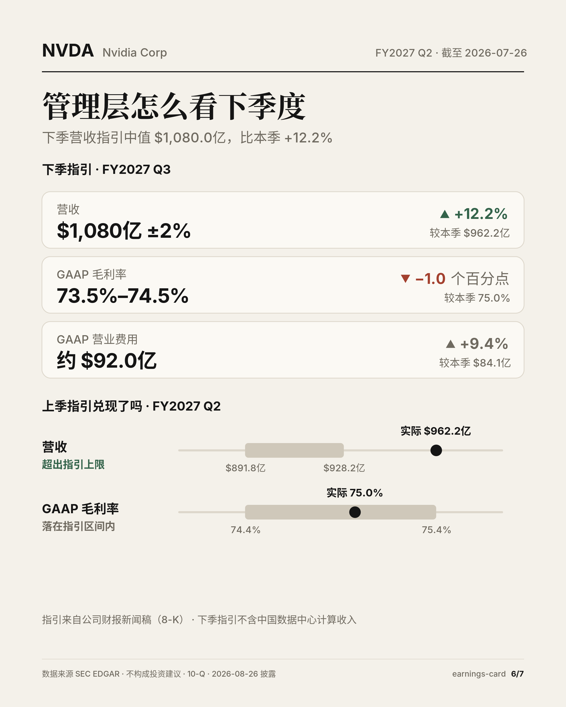<br><b>6 · 管理层指引</b><br>下季指引怎么说，上季指引兑现了没有</td>
</tr>
</table>

**7 · 横版封面**，1600×900，适合 X、公众号头图和 PPT：

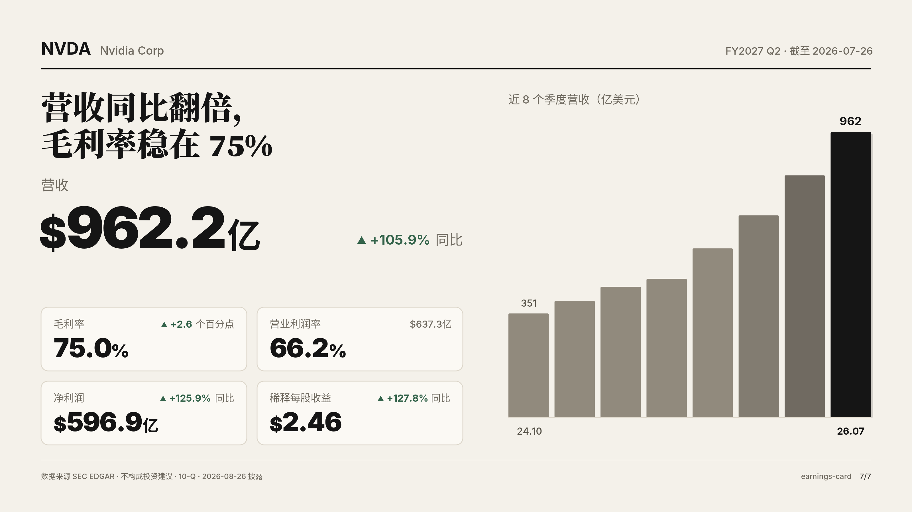

## 深色主题，任何公司

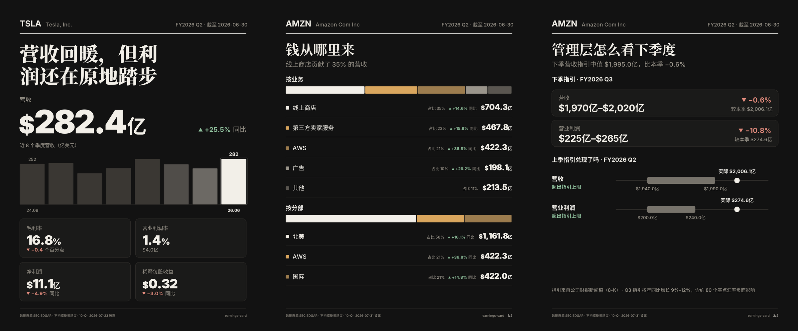

<table>
<tr>
<td width="50%">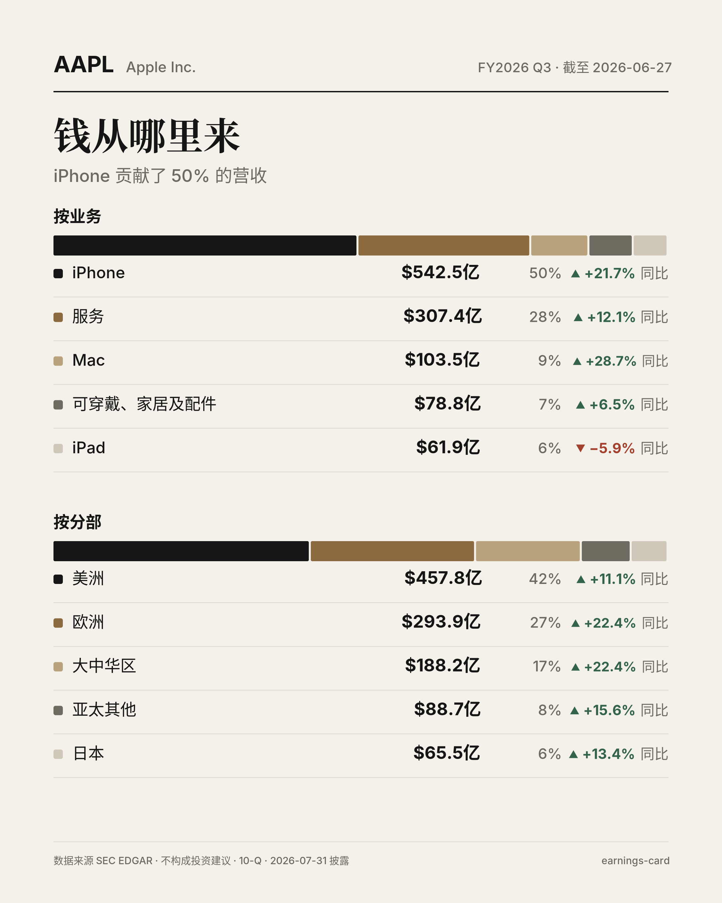<br>苹果：iPhone 贡献一半营收，同比增长 21.7%</td>
<td width="50%">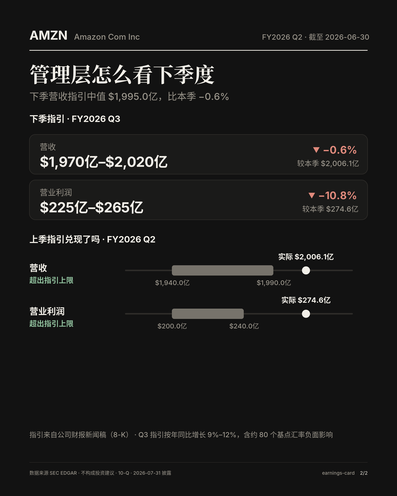<br>亚马逊：营收和营业利润都超出了自己给的指引上限</td>
</tr>
</table>

## 六种风格，也能用你自己的

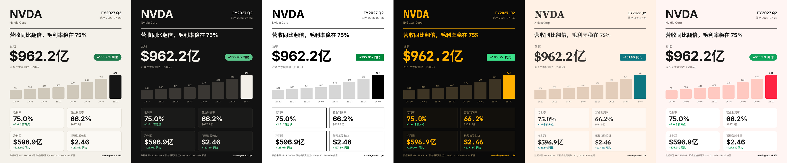

`杂志米白` `墨黑` `极简黑白` `终端` `财经报纸` `小红书色块`，一句话切换：「用终端风格给 NVDA 做一套」。

想要自己的配色、字体、@账号和头像水印？写一个小 JSON 就行（[说明](skills/earnings-card/styles/README.md)）：

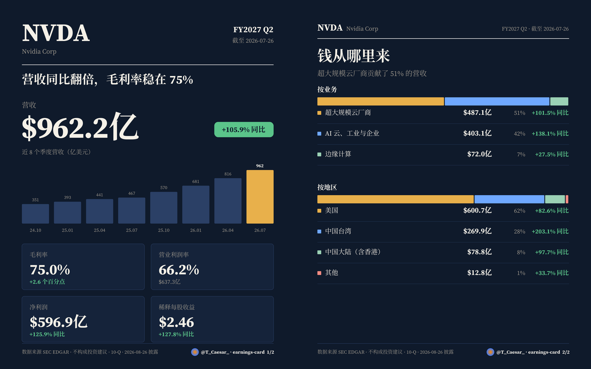

## 安装

```bash
npx skills add TTNAN/earnings-card
```

或者把 `skills/earnings-card` 复制到你的 Agent skills 目录（Claude Code：`~/.claude/skills/`，Codex：`~/.codex/skills/`）。

需要 Python 3.9+。导出 PNG 需要 `pip install cairosvg`，不装也能输出 SVG 和 HTML。

SEC 要求每个请求带上联系方式，设置一次即可：

```bash
export SEC_USER_AGENT="your-name you@example.com"
```

## 用法

直接对 Agent 说：

```
给 NVDA 做一套中文财报卡
苹果最新财报，做成深色的
只要特斯拉的封面和现金流两张
Make an earnings card for AAPL
```

也可以自己跑脚本：

```bash
cd skills/earnings-card/scripts
python3 fetch_sec.py NVDA --out nvda.json
python3 render.py nvda.json --out NVDA --headline "营收同比翻倍，毛利率稳在 75%" --lang zh --png
```

| 参数 | 作用 |
|---|---|
| `--lang en\|zh` | 英文或中文 |
| `--theme light\|dark` | 暖白纸感或墨黑 |
| `--cards cover,mix,profit,trend,cash,guide,wide` | 选择要哪几张 |
| `--guidance guidance.json` | 加上指引卡（Agent 从财报新闻稿里整理） |
| `--labels labels.json` | 给分部改名，比如翻成中文 |
| `--png` | 同时导出 PNG |

## 原理

```
股票代码 ─▶ SEC EDGAR companyfacts ─▶ 近 8 季 GAAP 数据
        └▶ 10-Q/10-K 原始 XBRL     ─▶ 分业务、分地区营收
        └▶ 8-K 财报新闻稿          ─▶ 指引原文 ─▶ Agent 整理成数字
                                        │
                        Agent 只根据数据写一句结论
                                        │
                        render.py ─▶ 7 张卡 · SVG · PNG · HTML
```

- 第四季度和单季现金流按标准方法推算（全年减前三季、累计值差分），并标注为推算。
- 分部拆分会自动挑出加总等于总营收、颗粒度最细的一组，不会把小计重复算进去。

## 限制

- 仅支持在 SEC 申报的美股公司，A 股、港股在路线图上。
- GAAP 口径，可能和新闻稿里的调整后数字不同。
- 分部营收需要 10-Q；财年第四季度（年报 10-K）这张卡会跳过。
- 只有公司在新闻稿里给出数字指引时才有指引卡。苹果、微软、特斯拉只在电话会上讲，这张卡会自动跳过。

## 开发

数字对不对是这个项目的命，所以每张卡上印出来的每个数字都有金标测试（`tests/golden`），分部拆分逻辑另有单测。不需要装任何依赖：

```bash
python3 -m unittest discover -s tests
```

有意改动卡片后，用 `UPDATE_GOLDEN=1` 重新生成快照，并在 PR 里说明变化。

## 路线图

- [ ] 对比市场一致预期，看超预期还是不及预期（自带预期值）
- [ ] 银行、保险公司专用版式
- [x] [七巨头财报在线画廊](https://ttnan.github.io/earnings-card/)
- [ ] A 股、港股

欢迎在 issue 里提想法和 bug。

## 请我喝杯咖啡

如果这个项目帮你省了点时间，欢迎请我喝杯咖啡。☕

| 支付宝 | 微信支付 |
| ------ | -------- |
|  |  |

## 协议

MIT，见 [LICENSE](LICENSE)。不构成投资建议。
